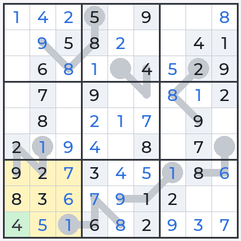

<!-- Written by tools/walkthrough.py slow-thermo: edit the script, not this page. -->
# Slow Thermo, step 32: the 4 in box 7

**Step 32 of 53** · [← Step 31](step-31.md) · [All steps](../slow-thermo.md#the-whole-puzzle-step-by-step) · [Step 33 →](step-33.md)

Box 7 needs a 4, and r9c1 is its last empty cell: **r9c1 = 4**.

**Step 32 of 53** · [← Step 31](step-31.md) · [All steps](../slow-thermo.md#the-whole-puzzle-step-by-step) · [Step 33 →](step-33.md)
