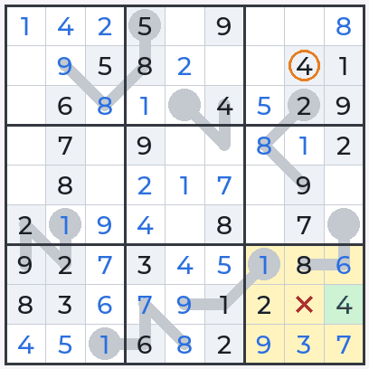

<!-- Written by tools/walkthrough.py slow-thermo: edit the script, not this page. -->
# Slow Thermo, step 33: the 4 in box 9

**Step 33 of 53** · [← Step 32](step-32.md) · [All steps](../slow-thermo.md#the-whole-puzzle-step-by-step) · [Step 34 →](step-34.md)

Box 9 needs a 4. r8c8: column 8 has one (r2c8). Only **r8c9** is left: **r8c9 = 4**.

**Step 33 of 53** · [← Step 32](step-32.md) · [All steps](../slow-thermo.md#the-whole-puzzle-step-by-step) · [Step 34 →](step-34.md)
