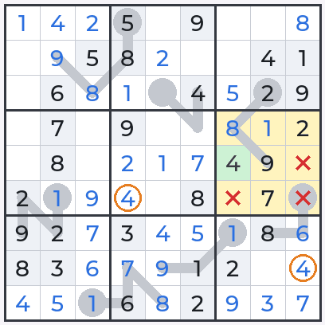

<!-- Written by tools/walkthrough.py slow-thermo: edit the script, not this page. -->
# Slow Thermo, step 34: the 4 in box 6

**Step 34 of 53** · [← Step 33](step-33.md) · [All steps](../slow-thermo.md#the-whole-puzzle-step-by-step) · [Step 35 →](step-35.md)

Box 6 needs a 4. r5c9: column 9 has one (r8c9). r6c7 and r6c9: row 6 has one (r6c4). Only **r5c7** is left: **r5c7 = 4**.

**Step 34 of 53** · [← Step 33](step-33.md) · [All steps](../slow-thermo.md#the-whole-puzzle-step-by-step) · [Step 35 →](step-35.md)
