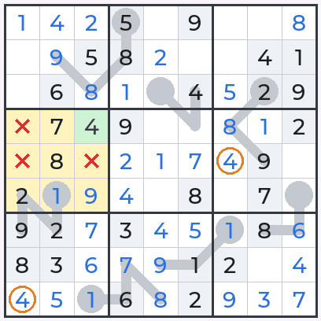

<!-- Written by tools/walkthrough.py slow-thermo: edit the script, not this page. -->
# Slow Thermo, step 35: the 4 in box 4

**Step 35 of 53** · [← Step 34](step-34.md) · [All steps](../slow-thermo.md#the-whole-puzzle-step-by-step) · [Step 36 →](step-36.md)

Box 4 needs a 4. r4c1: column 1 has one (r9c1). r5c1 and r5c3: row 5 has one (r5c7). Only **r4c3** is left: **r4c3 = 4**.

**Step 35 of 53** · [← Step 34](step-34.md) · [All steps](../slow-thermo.md#the-whole-puzzle-step-by-step) · [Step 36 →](step-36.md)
