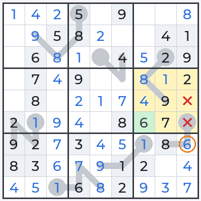

<!-- Written by tools/walkthrough.py slow-thermo: edit the script, not this page. -->
# Slow Thermo, step 36: the 6 in box 6

**Step 36 of 53** · [← Step 35](step-35.md) · [All steps](../slow-thermo.md#the-whole-puzzle-step-by-step) · [Step 37 →](step-37.md)

Box 6 needs a 6. r5c9 and r6c9: column 9 has one (r7c9). Only **r6c7** is left: **r6c7 = 6**.

**Step 36 of 53** · [← Step 35](step-35.md) · [All steps](../slow-thermo.md#the-whole-puzzle-step-by-step) · [Step 37 →](step-37.md)
