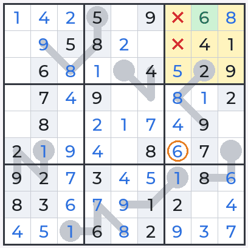

<!-- Written by tools/walkthrough.py slow-thermo: edit the script, not this page. -->
# Slow Thermo, step 37: the 6 in box 3

**Step 37 of 53** · [← Step 36](step-36.md) · [All steps](../slow-thermo.md#the-whole-puzzle-step-by-step) · [Step 38 →](step-38.md)

Box 3 needs a 6. r1c7 and r2c7: column 7 has one (r6c7). Only **r1c8** is left: **r1c8 = 6**.

**Step 37 of 53** · [← Step 36](step-36.md) · [All steps](../slow-thermo.md#the-whole-puzzle-step-by-step) · [Step 38 →](step-38.md)
