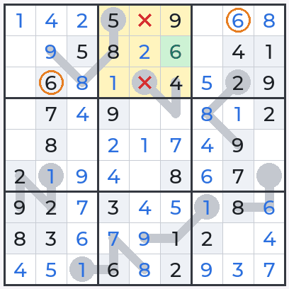

<!-- Written by tools/walkthrough.py slow-thermo: edit the script, not this page. -->
# Slow Thermo, step 38: the 6 in box 2

**Step 38 of 53** · [← Step 37](step-37.md) · [All steps](../slow-thermo.md#the-whole-puzzle-step-by-step) · [Step 39 →](step-39.md)

Box 2 needs a 6. r1c5: row 1 has one (r1c8). r3c5: row 3 has one (r3c2). Only **r2c6** is left: **r2c6 = 6**.

**Step 38 of 53** · [← Step 37](step-37.md) · [All steps](../slow-thermo.md#the-whole-puzzle-step-by-step) · [Step 39 →](step-39.md)
