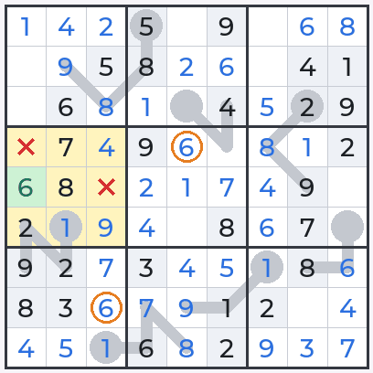

<!-- Written by tools/walkthrough.py slow-thermo: edit the script, not this page. -->
# Slow Thermo, step 40: the 6 in box 4

**Step 40 of 53** · [← Step 39](step-39.md) · [All steps](../slow-thermo.md#the-whole-puzzle-step-by-step) · [Step 41 →](step-41.md)

Box 4 needs a 6. r4c1: row 4 has one (r4c5). r5c3: column 3 has one (r8c3). Only **r5c1** is left: **r5c1 = 6**.

**Step 40 of 53** · [← Step 39](step-39.md) · [All steps](../slow-thermo.md#the-whole-puzzle-step-by-step) · [Step 41 →](step-41.md)
