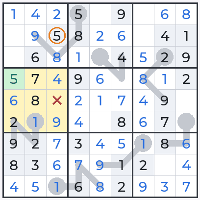

<!-- Written by tools/walkthrough.py slow-thermo: edit the script, not this page. -->
# Slow Thermo, step 41: the 5 in box 4

**Step 41 of 53** · [← Step 40](step-40.md) · [All steps](../slow-thermo.md#the-whole-puzzle-step-by-step) · [Step 42 →](step-42.md)

Box 4 needs a 5. r5c3: column 3 has one (r2c3). Only **r4c1** is left: **r4c1 = 5**.

**Step 41 of 53** · [← Step 40](step-40.md) · [All steps](../slow-thermo.md#the-whole-puzzle-step-by-step) · [Step 42 →](step-42.md)
