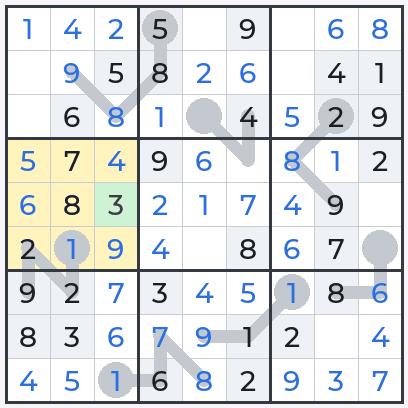

<!-- Written by tools/walkthrough.py slow-thermo: edit the script, not this page. -->
# Slow Thermo, step 42: the 3 in box 4

**Step 42 of 53** · [← Step 41](step-41.md) · [All steps](../slow-thermo.md#the-whole-puzzle-step-by-step) · [Step 43 →](step-43.md)

Box 4 needs a 3, and r5c3 is its last empty cell: **r5c3 = 3**.

**Step 42 of 53** · [← Step 41](step-41.md) · [All steps](../slow-thermo.md#the-whole-puzzle-step-by-step) · [Step 43 →](step-43.md)
