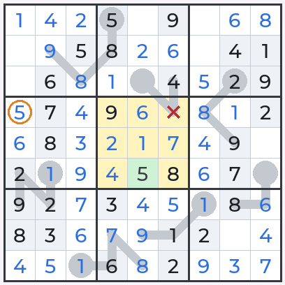

<!-- Written by tools/walkthrough.py slow-thermo: edit the script, not this page. -->
# Slow Thermo, step 43: the 5 in box 5

**Step 43 of 53** · [← Step 42](step-42.md) · [All steps](../slow-thermo.md#the-whole-puzzle-step-by-step) · [Step 44 →](step-44.md)

Box 5 needs a 5. r4c6: row 4 has one (r4c1). Only **r6c5** is left: **r6c5 = 5**.

**Step 43 of 53** · [← Step 42](step-42.md) · [All steps](../slow-thermo.md#the-whole-puzzle-step-by-step) · [Step 44 →](step-44.md)
