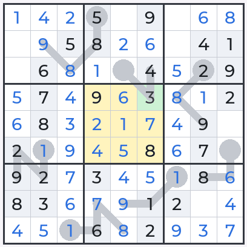

<!-- Written by tools/walkthrough.py slow-thermo: edit the script, not this page. -->
# Slow Thermo, step 44: the 3 in box 5

**Step 44 of 53** · [← Step 43](step-43.md) · [All steps](../slow-thermo.md#the-whole-puzzle-step-by-step) · [Step 45 →](step-45.md)

Box 5 needs a 3, and r4c6 is its last empty cell: **r4c6 = 3**.

**Step 44 of 53** · [← Step 43](step-43.md) · [All steps](../slow-thermo.md#the-whole-puzzle-step-by-step) · [Step 45 →](step-45.md)
