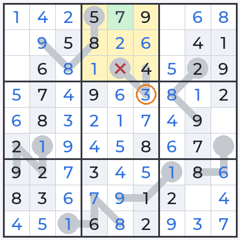

<!-- Written by tools/walkthrough.py slow-thermo: edit the script, not this page. -->
# Slow Thermo, step 45: the 7 in box 2

**Step 45 of 53** · [← Step 44](step-44.md) · [All steps](../slow-thermo.md#the-whole-puzzle-step-by-step) · [Step 46 →](step-46.md)

Box 2 needs a 7. r3c5: it comes before the 3 in r4c6 on its thermometer, so it's 3 or less. Only **r1c5** is left: **r1c5 = 7**.

**Step 45 of 53** · [← Step 44](step-44.md) · [All steps](../slow-thermo.md#the-whole-puzzle-step-by-step) · [Step 46 →](step-46.md)
