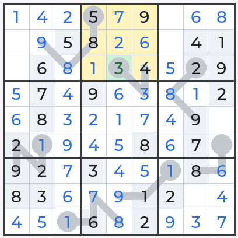

<!-- Written by tools/walkthrough.py slow-thermo: edit the script, not this page. -->
# Slow Thermo, step 46: the 3 in box 2

**Step 46 of 53** · [← Step 45](step-45.md) · [All steps](../slow-thermo.md#the-whole-puzzle-step-by-step) · [Step 47 →](step-47.md)

Box 2 needs a 3, and r3c5 is its last empty cell: **r3c5 = 3**.

**Step 46 of 53** · [← Step 45](step-45.md) · [All steps](../slow-thermo.md#the-whole-puzzle-step-by-step) · [Step 47 →](step-47.md)
