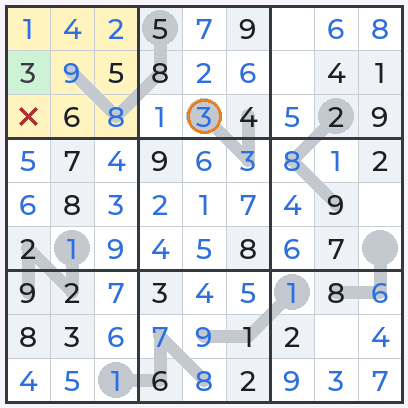

<!-- Written by tools/walkthrough.py slow-thermo: edit the script, not this page. -->
# Slow Thermo, step 47: the 3 in box 1

**Step 47 of 53** · [← Step 46](step-46.md) · [All steps](../slow-thermo.md#the-whole-puzzle-step-by-step) · [Step 48 →](step-48.md)

Box 1 needs a 3. r3c1: row 3 has one (r3c5). Only **r2c1** is left: **r2c1 = 3**.

**Step 47 of 53** · [← Step 46](step-46.md) · [All steps](../slow-thermo.md#the-whole-puzzle-step-by-step) · [Step 48 →](step-48.md)
