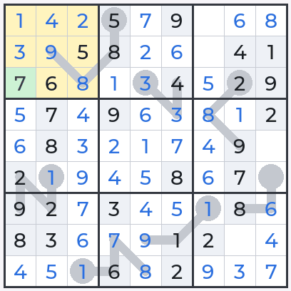

<!-- Written by tools/walkthrough.py slow-thermo: edit the script, not this page. -->
# Slow Thermo, step 48: the 7 in box 1

**Step 48 of 53** · [← Step 47](step-47.md) · [All steps](../slow-thermo.md#the-whole-puzzle-step-by-step) · [Step 49 →](step-49.md)

Box 1 needs a 7, and r3c1 is its last empty cell: **r3c1 = 7**.

**Step 48 of 53** · [← Step 47](step-47.md) · [All steps](../slow-thermo.md#the-whole-puzzle-step-by-step) · [Step 49 →](step-49.md)
