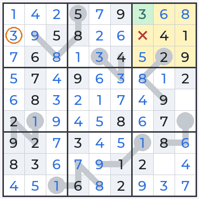

<!-- Written by tools/walkthrough.py slow-thermo: edit the script, not this page. -->
# Slow Thermo, step 49: the 3 in box 3

**Step 49 of 53** · [← Step 48](step-48.md) · [All steps](../slow-thermo.md#the-whole-puzzle-step-by-step) · [Step 50 →](step-50.md)

Box 3 needs a 3. r2c7: row 2 has one (r2c1). Only **r1c7** is left: **r1c7 = 3**.

**Step 49 of 53** · [← Step 48](step-48.md) · [All steps](../slow-thermo.md#the-whole-puzzle-step-by-step) · [Step 50 →](step-50.md)
