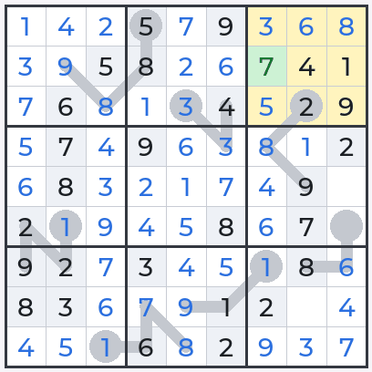

<!-- Written by tools/walkthrough.py slow-thermo: edit the script, not this page. -->
# Slow Thermo, step 50: the 7 in box 3

**Step 50 of 53** · [← Step 49](step-49.md) · [All steps](../slow-thermo.md#the-whole-puzzle-step-by-step) · [Step 51 →](step-51.md)

Box 3 needs a 7, and r2c7 is its last empty cell: **r2c7 = 7**.

**Step 50 of 53** · [← Step 49](step-49.md) · [All steps](../slow-thermo.md#the-whole-puzzle-step-by-step) · [Step 51 →](step-51.md)
