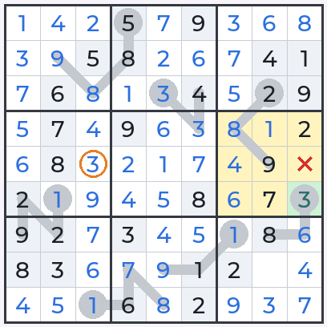

<!-- Written by tools/walkthrough.py slow-thermo: edit the script, not this page. -->
# Slow Thermo, step 51: the 3 in box 6

**Step 51 of 53** · [← Step 50](step-50.md) · [All steps](../slow-thermo.md#the-whole-puzzle-step-by-step) · [Step 52 →](step-52.md)

Box 6 needs a 3. r5c9: row 5 has one (r5c3). Only **r6c9** is left: **r6c9 = 3**.

**Step 51 of 53** · [← Step 50](step-50.md) · [All steps](../slow-thermo.md#the-whole-puzzle-step-by-step) · [Step 52 →](step-52.md)
