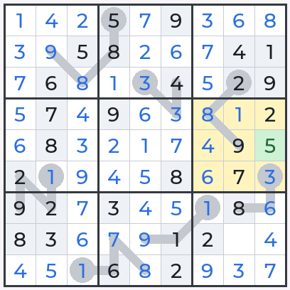

<!-- Written by tools/walkthrough.py slow-thermo: edit the script, not this page. -->
# Slow Thermo, step 52: the 5 in box 6

**Step 52 of 53** · [← Step 51](step-51.md) · [All steps](../slow-thermo.md#the-whole-puzzle-step-by-step) · [Step 53 →](step-53.md)

Box 6 needs a 5, and r5c9 is its last empty cell: **r5c9 = 5**.

**Step 52 of 53** · [← Step 51](step-51.md) · [All steps](../slow-thermo.md#the-whole-puzzle-step-by-step) · [Step 53 →](step-53.md)
