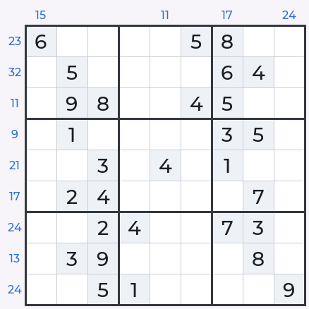

# Sum Skyscrapers

[← All variants](README.md) · [Puzzles](../features-puzzles.md) · [How to play](../how-to-play.md)

## The rules

[Classic](classic.md) rules, and **clues** left of some rows and above some columns. Each digit is a building that tall; looking from the clue along the row (or down the column), a taller building hides every shorter one behind it. The clue is **the sum of the buildings seen**. In 2, 5, 1, 9, 8 the buildings seen are 2, 5 and 9: the clue is 16. A line without a clue has no such rule.

## On the board

- The clues are in blue in a margin left of the rows and above the columns; a line without a clue has none.
- The cells from the clue up to the first empty cell (or the 9) turn red when the buildings seen already add up to more than the clue, or, the 9 reached, to something else.
- The grader and hints try every order of a line's last few missing digits against its clue: "From the clue of row 7, the buildings seen add up to 24 ...".
- **Puzzles → ⋮ → New puzzle → Clues → Sum Skyscrapers**: about three quarters of the lines have a clue (Hard and Expert: about 60 %).

## How to solve it

- **The 9 is always seen**, so a clue is at least 9. **A clue of 9:** the line starts with 9 (nothing else is seen). **Any other clue:** it doesn't start with 9, and its first cell is at most the clue less 9 (it's seen, and so is the 9).
- **Only taller ones count:** after an 8, nothing but the 9 can be seen, so a line starting with 8 has the clue 17.
- **A big clue needs many buildings seen**, in rising order before the 9: 45 is 1, 2, ..., 9 in order.

## Worked example

**variant-examples #45**, Sum Skyscrapers Easy (see [Classic](classic.md#worked-example-the-whole-puzzle) for how to import the examples; cells are written r*row*c*column*). The clues are in the picture; from the left, row 7's is **24** and row 8's **13**.

**Step 1: r7c1, row 7 (clue 24).** Row 7 has 2, 4, 7 and 3; box 7 has 5 and 9; column 1 has 6: that leaves 1 and 8. An 8 first would only let the 9 be seen after it: 8 + 9 = 17, not 24. **r7c1 = 1**.

**Step 2: r7c2, row 7 again.** Now 1, 2, 3, 4, 5, 7 and 9 are ruled out for r7c2: that leaves 6 and 8. With 1, 8 and then only the 9 seen, the row would add up to 18. **r7c2 = 6** (1 + 6 + 8 + 9 = 24).

**Step 3: r8c1, row 8 (clue 13).** Row 8 has 3, 9 and 8; column 1 has 6 and 1; box 7 has 2 and 5: that leaves 4 and 7. Row 8 reads r8c1, 3, 9: with a 7 first, 7 and 9 are seen, 16, more than 13. **r8c1 = 4** (4 + 9 = 13).

## The whole puzzle, step by step

<!-- walkthrough -->
<!-- Written by tools/walkthrough.py sum-skyscrapers: edit the script, not this part. -->

The whole puzzle, from the start to the last cell: 52 steps, each one a single (one place left for a digit, or one digit left for a cell), taken in the order a box's single comes first, so not quite the order of the worked example above. Each step has a page of its own, with **Previous** and **Next**: pick one from the list below. In each picture, the unit the step looks at is tinted yellow (for a cell with one digit left: its row, column and box), the new digit is on green, the digits that rule cells out have an **orange ring**, and the empty cells they rule out a **red cross**. Givens are on grey, digits from earlier steps in blue.

1. [the 3 in box 1](sum-skyscrapers/step-01.md)
2. [the 2 in box 1](sum-skyscrapers/step-02.md)
3. [the 4 in box 1](sum-skyscrapers/step-03.md)
4. [the 9 in box 3](sum-skyscrapers/step-04.md)
5. [the 9 in box 4](sum-skyscrapers/step-05.md)
6. [the 4 in box 6](sum-skyscrapers/step-06.md)
7. [the 9 in box 6](sum-skyscrapers/step-07.md)
8. [the 8 in column 1](sum-skyscrapers/step-08.md)
9. [the 5 in box 4](sum-skyscrapers/step-09.md)
10. [the 8 in box 6](sum-skyscrapers/step-10.md)
11. [the 2 in box 6](sum-skyscrapers/step-11.md)
12. [the 6 in box 6](sum-skyscrapers/step-12.md)
13. [the 6 in box 9](sum-skyscrapers/step-13.md)
14. [the 6 in box 7](sum-skyscrapers/step-14.md)
15. [the 6 in box 4](sum-skyscrapers/step-15.md)
16. [the 7 in box 4](sum-skyscrapers/step-16.md)
17. [the 7 in box 7](sum-skyscrapers/step-17.md)
18. [the 4 in box 7](sum-skyscrapers/step-18.md)
19. [the 1 in box 7](sum-skyscrapers/step-19.md)
20. [the 8 in box 7](sum-skyscrapers/step-20.md)
21. [the 9 in box 8](sum-skyscrapers/step-21.md)
22. [the 9 in box 5](sum-skyscrapers/step-22.md)
23. [the 9 in box 2](sum-skyscrapers/step-23.md)
24. [the 6 in box 5](sum-skyscrapers/step-24.md)
25. [the 8 in box 8](sum-skyscrapers/step-25.md)
26. [the 1 in box 9](sum-skyscrapers/step-26.md)
27. [the 1 in box 3](sum-skyscrapers/step-27.md)
28. [the 1 in box 2](sum-skyscrapers/step-28.md)
29. [the 1 in box 1](sum-skyscrapers/step-29.md)
30. [the 7 in box 1](sum-skyscrapers/step-30.md)
31. [the 8 in box 2](sum-skyscrapers/step-31.md)
32. [the 1 in box 5](sum-skyscrapers/step-32.md)
33. [the 5 in box 5](sum-skyscrapers/step-33.md)
34. [the 3 in box 5](sum-skyscrapers/step-34.md)
35. [the 8 in box 5](sum-skyscrapers/step-35.md)
36. [the 3 in box 8](sum-skyscrapers/step-36.md)
37. [the 5 in box 8](sum-skyscrapers/step-37.md)
38. [the 6 in box 8](sum-skyscrapers/step-38.md)
39. [the 6 in box 2](sum-skyscrapers/step-39.md)
40. [the 7 in box 8](sum-skyscrapers/step-40.md)
41. [the 2 in box 8](sum-skyscrapers/step-41.md)
42. [the 2 in box 9](sum-skyscrapers/step-42.md)
43. [the 4 in box 9](sum-skyscrapers/step-43.md)
44. [the 5 in box 9](sum-skyscrapers/step-44.md)
45. [the 2 in row 2](sum-skyscrapers/step-45.md)
46. [the 7 in column 5](sum-skyscrapers/step-46.md)
47. [the 2 in box 5](sum-skyscrapers/step-47.md)
48. [the 2 in box 2](sum-skyscrapers/step-48.md)
49. [the 7 in box 2](sum-skyscrapers/step-49.md)
50. [the 3 in box 2](sum-skyscrapers/step-50.md)
51. [the 3 in box 3](sum-skyscrapers/step-51.md)
52. [the 7 in box 3](sum-skyscrapers/step-52.md)

Solved.

<!-- /walkthrough -->
