# Sum Skyscrapers

[← All variants](README.md) · [Puzzles](../features-puzzles.md) · [How to play](../how-to-play.md)

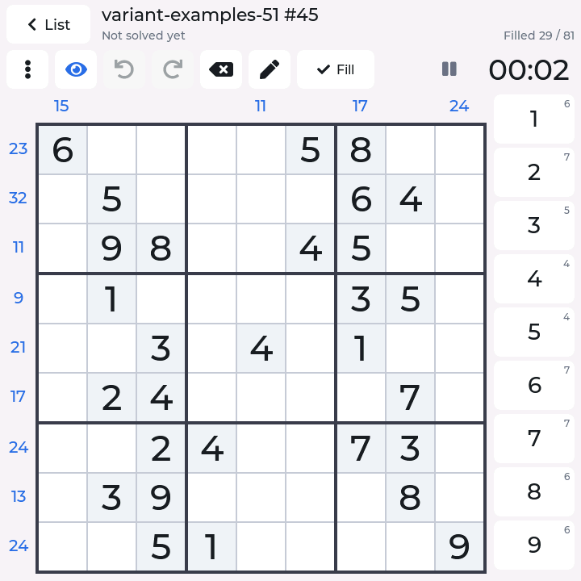

## The rules

[Classic](classic.md) rules, and **clues** left of some rows and above some columns. Each digit is a building that tall; looking from the clue along the row (or down the column), a taller building hides every shorter one behind it. The clue is **the sum of the buildings seen**. In 2, 5, 1, 9, 8 the buildings seen are 2, 5 and 9: the clue is 16. A line without a clue has no such rule.

## On the board

- The clues are in blue in a margin left of the rows and above the columns; a line without a clue has none.
- The cells from the clue up to the first empty cell (or the 9) turn red when the buildings seen already add up to more than the clue, or, the 9 reached, to something else.
- The grader and hints try every order of a line's last few missing digits against its clue: "From the clue of row 7, the buildings seen add up to 24 ...".
- **Puzzles → ⋮ → New puzzle → Clues → Sum Skyscrapers**: about three quarters of the lines have a clue (Hard and Expert: about 60 %).

## How to solve it

- **The 9 is always seen**, so a clue is at least 9. **A clue of 9:** the line starts with 9 (nothing else is seen). **Any other clue:** it doesn't start with 9, and its first cell is at most the clue less 9 (it's seen, and so is the 9).
- **Only taller ones count:** after an 8, nothing but the 9 can be seen, so a line starting with 8 has the clue 17.
- **A big clue needs many buildings seen**, in rising order before the 9: 45 is 1, 2, ..., 9 in order.

## Worked example

**variant-examples #45**, Sum Skyscrapers Easy (see [Classic](classic.md#worked-example-the-whole-puzzle) for how to import the examples; cells are written r*row*c*column*). The clues are in the picture; from the left, row 7's is **24** and row 8's **13**.

**Step 1: r7c1, row 7 (clue 24).** Row 7 has 2, 4, 7 and 3; box 7 has 5 and 9; column 1 has 6: that leaves 1 and 8. An 8 first would only let the 9 be seen after it: 8 + 9 = 17, not 24. **r7c1 = 1**.

**Step 2: r7c2, row 7 again.** Now 1, 2, 3, 4, 5, 7 and 9 are ruled out for r7c2: that leaves 6 and 8. With 1, 8 and then only the 9 seen, the row would add up to 18. **r7c2 = 6** (1 + 6 + 8 + 9 = 24).

**Step 3: r8c1, row 8 (clue 13).** Row 8 has 3, 9 and 8; column 1 has 6 and 1; box 7 has 2 and 5: that leaves 4 and 7. Row 8 reads r8c1, 3, 9: with a 7 first, 7 and 9 are seen, 16, more than 13. **r8c1 = 4** (4 + 9 = 13).

## The whole puzzle, step by step

<!-- walkthrough -->
<!-- Written by tools/walkthrough.py sum-skyscrapers: edit the script, not this part. -->

The whole puzzle, from the start to the last cell: 52 steps, each one a single (one place left for a digit, or one digit left for a cell), taken in the order a box's single comes first, so not quite the order of the worked example above. In each picture, the unit the step looks at is tinted yellow (for a cell with one digit left: its row, column and box), the new digit is on green, the digits that rule cells out have an **orange ring**, and the empty cells they rule out a **red cross**. Givens are on grey, digits from earlier steps in blue.

#### Step 1: the 3 in box 1

Box 1 needs a 3. r1c2: column 2 has one (r8c2). r1c3 and r2c3: column 3 has one (r5c3). r3c1: it's the first cell after a clue of 11: it's seen, and so is the 9 later, so it's at most 2. Only **r2c1** is left: **r2c1 = 3**.

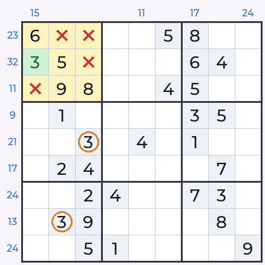

#### Step 2: the 2 in box 1

Box 1 needs a 2. r1c2: column 2 has one (r6c2). r1c3 and r2c3: column 3 has one (r7c3). Only **r3c1** is left: **r3c1 = 2**.

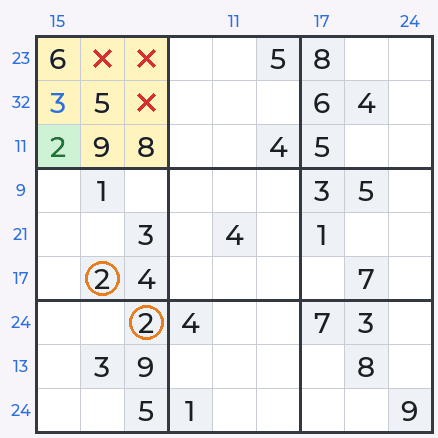

#### Step 3: the 4 in box 1

Box 1 needs a 4. r1c3: column 3 has one (r6c3). r2c3: row 2 has one (r2c8). Only **r1c2** is left: **r1c2 = 4**.

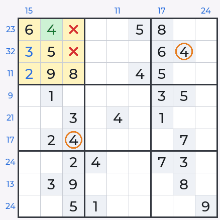

#### Step 4: the 9 in box 3

Box 3 needs a 9. r1c9 and r2c9: column 9 has one (r9c9). r3c8 and r3c9: row 3 has one (r3c2). Only **r1c8** is left: **r1c8 = 9**.

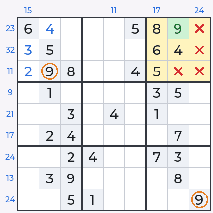

#### Step 5: the 9 in box 4

Box 4 needs a 9. r4c3: column 3 has one (r8c3). r5c2: column 2 has one (r3c2). r5c1: it's the first cell after a clue of 21: a 9 first would be all that's seen, 9. r6c1: it's the first cell after a clue of 17: a 9 first would be all that's seen, 9. Only **r4c1** is left: **r4c1 = 9**.

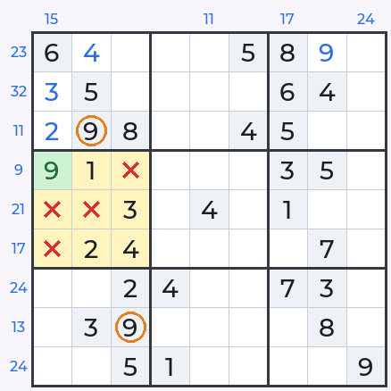

#### Step 6: the 4 in box 6

Box 6 needs a 4. r5c8 and r5c9: row 5 has one (r5c5). r6c7 and r6c9: row 6 has one (r6c3). Only **r4c9** is left: **r4c9 = 4**.

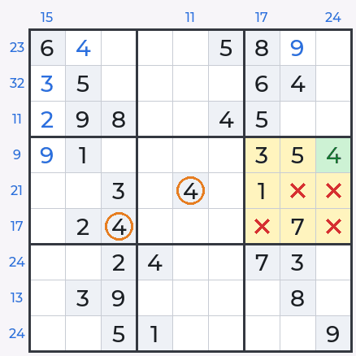

#### Step 7: the 9 in box 6

Box 6 needs a 9. r5c8: column 8 has one (r1c8). r5c9 and r6c9: column 9 has one (r9c9). Only **r6c7** is left: **r6c7 = 9**.

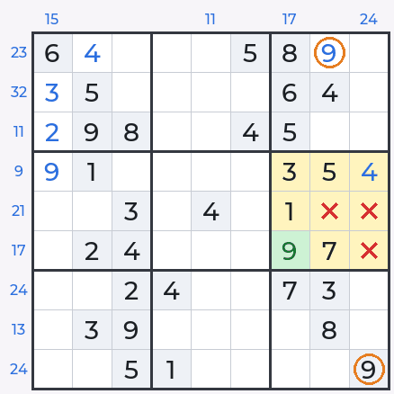

#### Step 8: the 8 in column 1

Column 1 needs an 8. r8c1: row 8 has one (r8c8). r5c1: seen from the left of row 5, an 8 there would leave too little to make its clue 21. r7c1: seen from the left of row 7, an 8 there would leave too little to make its clue 24. r9c1: seen from the left of row 9, an 8 there would leave too little to make its clue 24. Only **r6c1** is left: **r6c1 = 8**.

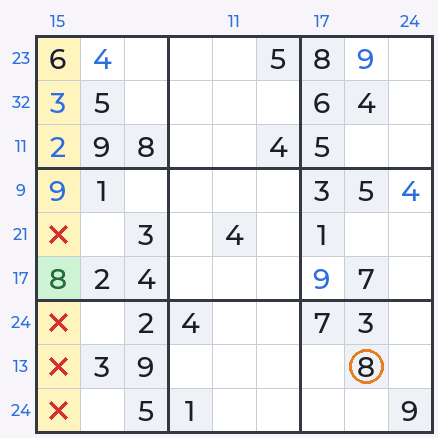

#### Step 9: the 5 in box 4

Box 4 needs a 5. r4c3: row 4 has one (r4c8). r5c2: column 2 has one (r2c2). Only **r5c1** is left: **r5c1 = 5**.

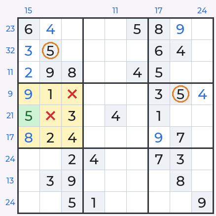

#### Step 10: the 8 in box 6

Box 6 needs an 8. r5c8: column 8 has one (r8c8). r6c9: row 6 has one (r6c1). Only **r5c9** is left: **r5c9 = 8**.

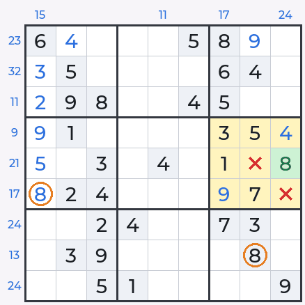

#### Step 11: the 2 in box 6

Box 6 needs a 2. r6c9: row 6 has one (r6c2). Only **r5c8** is left: **r5c8 = 2**.

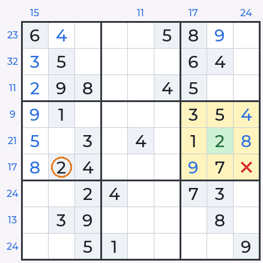

#### Step 12: the 6 in box 6

Box 6 needs a 6, and r6c9 is its last empty cell: **r6c9 = 6**.

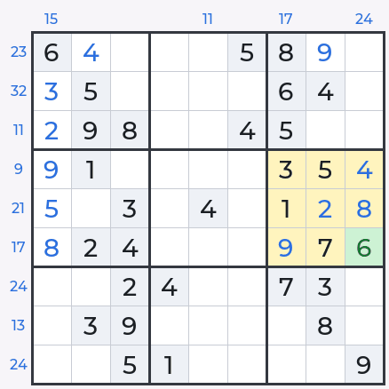

#### Step 13: the 6 in box 9

Box 9 needs a 6. r7c9 and r8c9: column 9 has one (r6c9). r8c7 and r9c7: column 7 has one (r2c7). Only **r9c8** is left: **r9c8 = 6**.

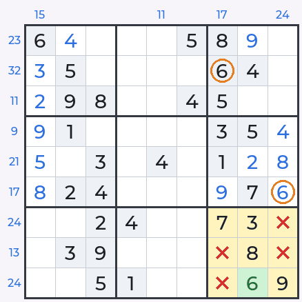

#### Step 14: the 6 in box 7

Box 7 needs a 6. r7c1 and r8c1: column 1 has one (r1c1). r9c1 and r9c2: row 9 has one (r9c8). Only **r7c2** is left: **r7c2 = 6**.

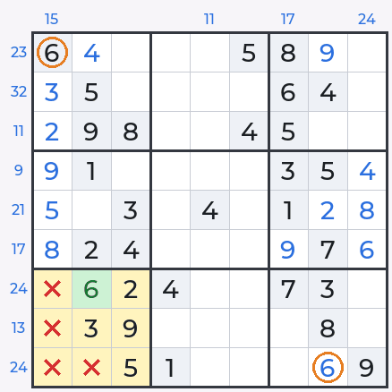

#### Step 15: the 6 in box 4

Box 4 needs a 6. r5c2: column 2 has one (r7c2). Only **r4c3** is left: **r4c3 = 6**.

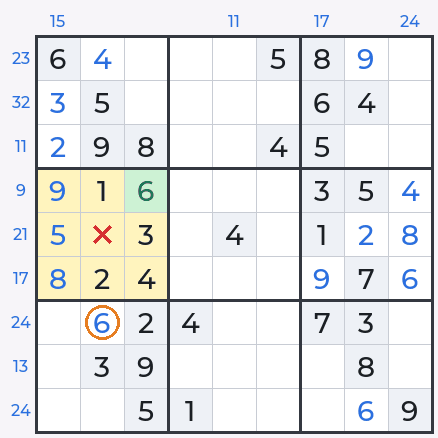

#### Step 16: the 7 in box 4

Box 4 needs a 7, and r5c2 is its last empty cell: **r5c2 = 7**.

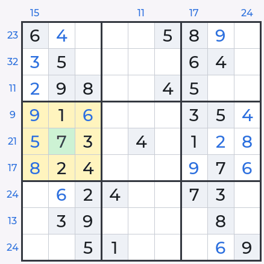

#### Step 17: the 7 in box 7

Box 7 needs a 7. r7c1: row 7 has one (r7c7). r9c2: column 2 has one (r5c2). r8c1: it's the first cell after a clue of 13: it's seen, and so is the 9 later, so it's at most 4. Only **r9c1** is left: **r9c1 = 7**.

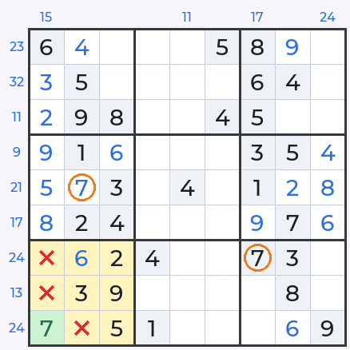

#### Step 18: the 4 in box 7

Box 7 needs a 4. r7c1: row 7 has one (r7c4). r9c2: column 2 has one (r1c2). Only **r8c1** is left: **r8c1 = 4**.

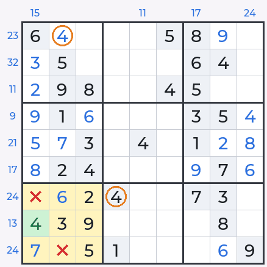

#### Step 19: the 1 in box 7

Box 7 needs a 1. r9c2: row 9 has one (r9c4). Only **r7c1** is left: **r7c1 = 1**.

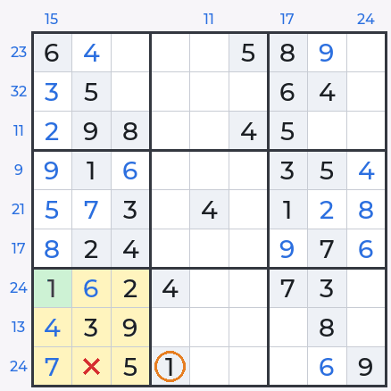

#### Step 20: the 8 in box 7

Box 7 needs an 8, and r9c2 is its last empty cell: **r9c2 = 8**.

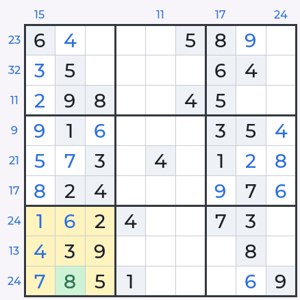

#### Step 21: the 9 in box 8

Box 8 needs a 9. r8c4, r8c5 and r8c6: row 8 has one (r8c3). r9c5 and r9c6: row 9 has one (r9c9). r7c5: seen from the left of row 7, 1, 6 and 9 would add up to 16 with a 9 there, not its clue 24. Only **r7c6** is left: **r7c6 = 9**.

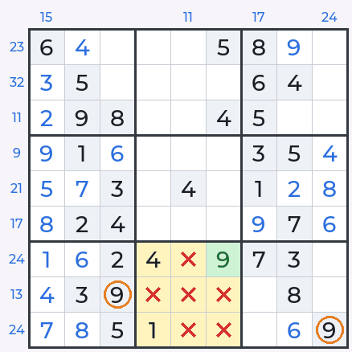

#### Step 22: the 9 in box 5

Box 5 needs a 9. r4c4, r4c5 and r4c6: row 4 has one (r4c1). r5c6: column 6 has one (r7c6). r6c4, r6c5 and r6c6: row 6 has one (r6c7). Only **r5c4** is left: **r5c4 = 9**.

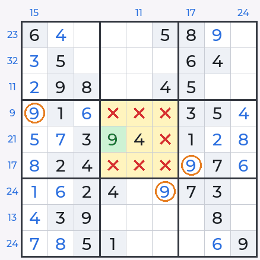

#### Step 23: the 9 in box 2

Box 2 needs a 9. r1c4 and r1c5: row 1 has one (r1c8). r2c4: column 4 has one (r5c4). r2c6: column 6 has one (r7c6). r3c4 and r3c5: row 3 has one (r3c2). Only **r2c5** is left: **r2c5 = 9**.

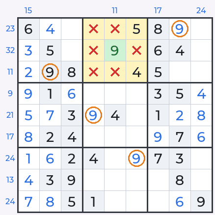

#### Step 24: the 6 in box 5

Box 5 needs a 6. r4c4, r4c5 and r4c6: row 4 has one (r4c3). r6c4, r6c5 and r6c6: row 6 has one (r6c9). Only **r5c6** is left: **r5c6 = 6**.

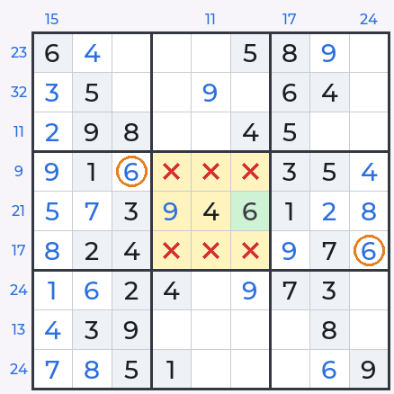

#### Step 25: the 8 in box 8

Box 8 needs an 8. r8c4, r8c5 and r8c6: row 8 has one (r8c8). r9c5 and r9c6: row 9 has one (r9c2). Only **r7c5** is left: **r7c5 = 8**.

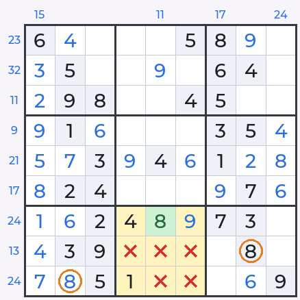

#### Step 26: the 1 in box 9

Box 9 needs a 1. r7c9: row 7 has one (r7c1). r8c7: column 7 has one (r5c7). r9c7: row 9 has one (r9c4). Only **r8c9** is left: **r8c9 = 1**.

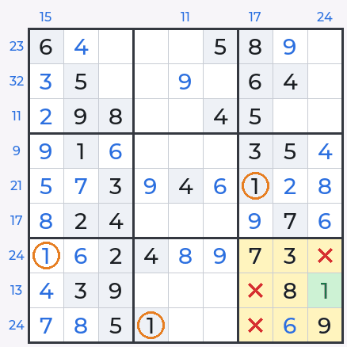

#### Step 27: the 1 in box 3

Box 3 needs a 1. r1c9, r2c9 and r3c9: column 9 has one (r8c9). Only **r3c8** is left: **r3c8 = 1**.

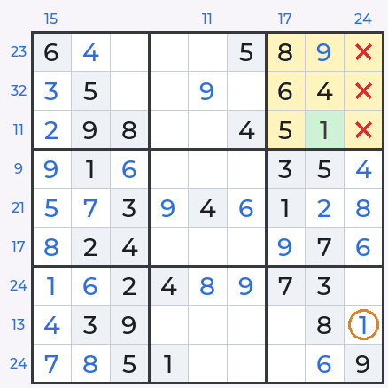

#### Step 28: the 1 in box 2

Box 2 needs a 1. r1c4 and r2c4: column 4 has one (r9c4). r3c4 and r3c5: row 3 has one (r3c8). r1c5: seen from the top of column 5, 1 and 9 would add up to 10 with a 1 there, not its clue 11. Only **r2c6** is left: **r2c6 = 1**.

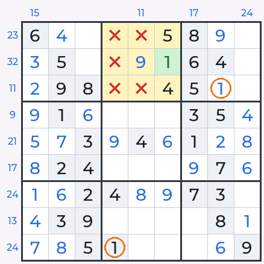

#### Step 29: the 1 in box 1

Box 1 needs a 1. r2c3: row 2 has one (r2c6). Only **r1c3** is left: **r1c3 = 1**.

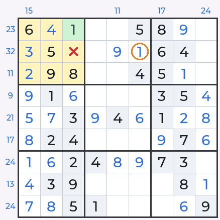

#### Step 30: the 7 in box 1

Box 1 needs a 7, and r2c3 is its last empty cell: **r2c3 = 7**.

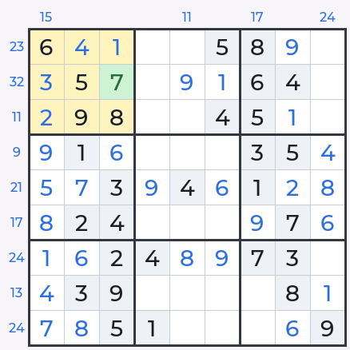

#### Step 31: the 8 in box 2

Box 2 needs an 8. r1c4 and r1c5: row 1 has one (r1c7). r3c4 and r3c5: row 3 has one (r3c3). Only **r2c4** is left: **r2c4 = 8**.

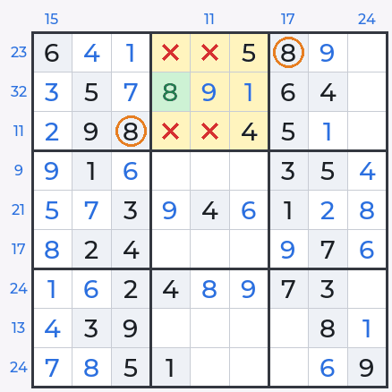

#### Step 32: the 1 in box 5

Box 5 needs a 1. r4c4, r4c5 and r4c6: row 4 has one (r4c2). r6c4: column 4 has one (r9c4). r6c6: column 6 has one (r2c6). Only **r6c5** is left: **r6c5 = 1**.

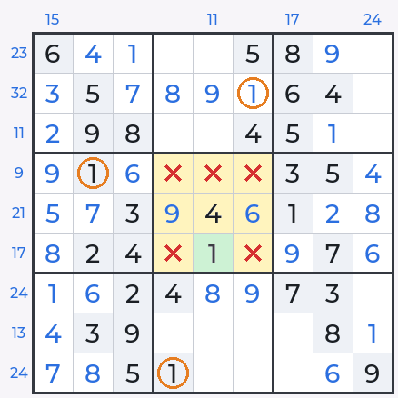

#### Step 33: the 5 in box 5

Box 5 needs a 5. r4c4, r4c5 and r4c6: row 4 has one (r4c8). r6c6: column 6 has one (r1c6). Only **r6c4** is left: **r6c4 = 5**.

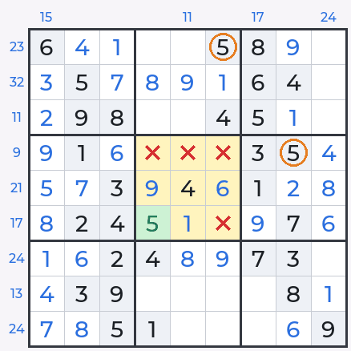

#### Step 34: the 3 in box 5

Box 5 needs a 3. r4c4, r4c5 and r4c6: row 4 has one (r4c7). Only **r6c6** is left: **r6c6 = 3**.

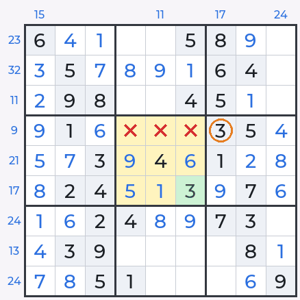

#### Step 35: the 8 in box 5

Box 5 needs an 8. r4c4: column 4 has one (r2c4). r4c5: column 5 has one (r7c5). Only **r4c6** is left: **r4c6 = 8**.

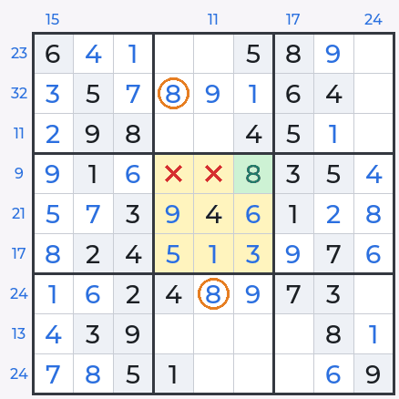

#### Step 36: the 3 in box 8

Box 8 needs a 3. r8c4, r8c5 and r8c6: row 8 has one (r8c2). r9c6: column 6 has one (r6c6). Only **r9c5** is left: **r9c5 = 3**.

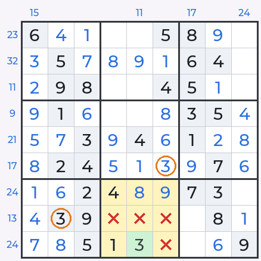

#### Step 37: the 5 in box 8

Box 8 needs a 5. r8c4: column 4 has one (r6c4). r8c6: column 6 has one (r1c6). r9c6: row 9 has one (r9c3). Only **r8c5** is left: **r8c5 = 5**.

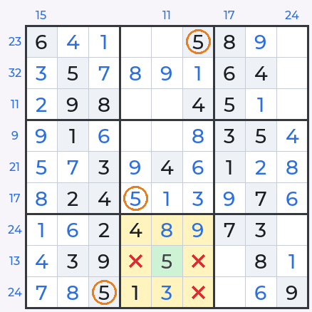

#### Step 38: the 6 in box 8

Box 8 needs a 6. r8c6: column 6 has one (r5c6). r9c6: row 9 has one (r9c8). Only **r8c4** is left: **r8c4 = 6**.

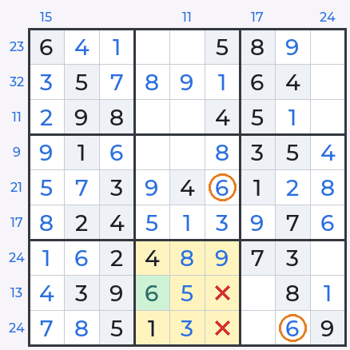

#### Step 39: the 6 in box 2

Box 2 needs a 6. r1c4 and r1c5: row 1 has one (r1c1). r3c4: column 4 has one (r8c4). Only **r3c5** is left: **r3c5 = 6**.

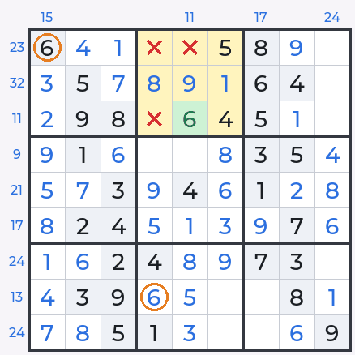

#### Step 40: the 7 in box 8

Box 8 needs a 7. r9c6: row 9 has one (r9c1). Only **r8c6** is left: **r8c6 = 7**.

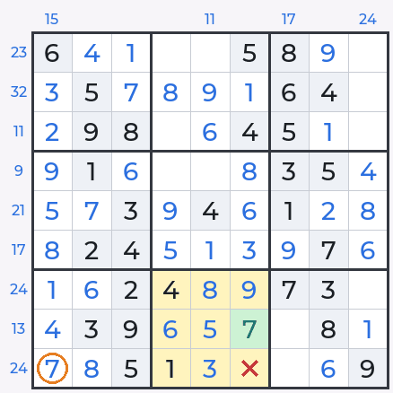

#### Step 41: the 2 in box 8

Box 8 needs a 2, and r9c6 is its last empty cell: **r9c6 = 2**.

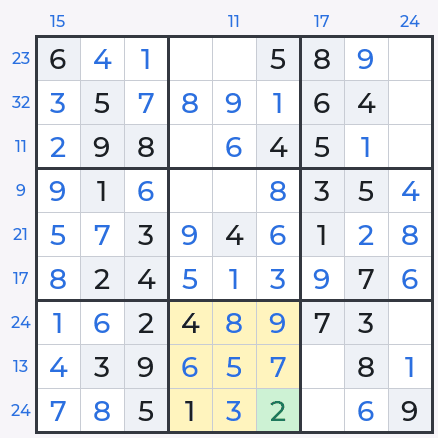

#### Step 42: the 2 in box 9

Box 9 needs a 2. r7c9: row 7 has one (r7c3). r9c7: row 9 has one (r9c6). Only **r8c7** is left: **r8c7 = 2**.

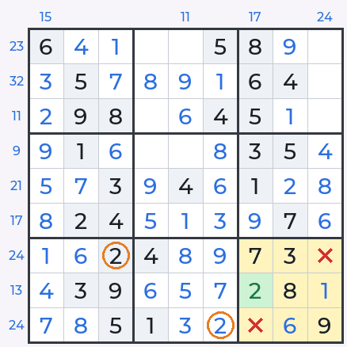

#### Step 43: the 4 in box 9

Box 9 needs a 4. r7c9: row 7 has one (r7c4). Only **r9c7** is left: **r9c7 = 4**.

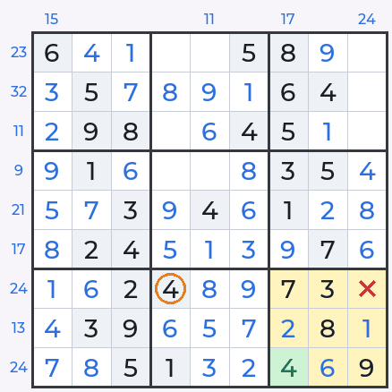

#### Step 44: the 5 in box 9

Box 9 needs a 5, and r7c9 is its last empty cell: **r7c9 = 5**.

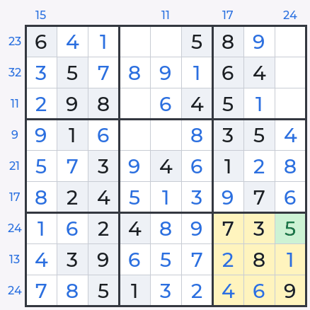

#### Step 45: the 2 in row 2

Row 2 needs a 2, and r2c9 is its last empty cell: **r2c9 = 2**.

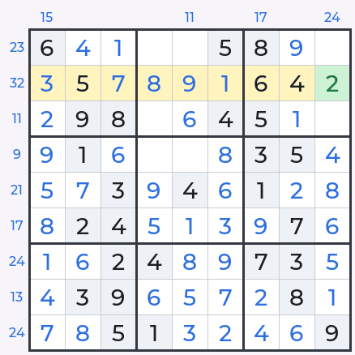

#### Step 46: the 7 in column 5

Column 5 needs a 7. r1c5: it's the first cell after a clue of 11: it's seen, and so is the 9 later, so it's at most 2. Only **r4c5** is left: **r4c5 = 7**.

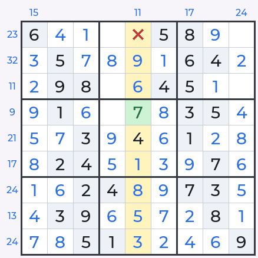

#### Step 47: the 2 in box 5

Box 5 needs a 2, and r4c4 is its last empty cell: **r4c4 = 2**.

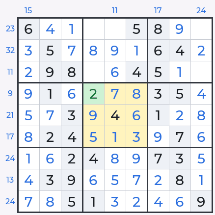

#### Step 48: the 2 in box 2

Box 2 needs a 2. r1c4: column 4 has one (r4c4). r3c4: row 3 has one (r3c1). Only **r1c5** is left: **r1c5 = 2**.

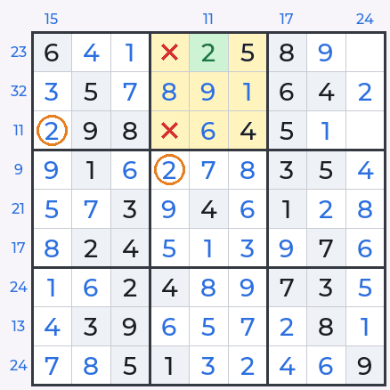

#### Step 49: the 7 in box 2

Box 2 needs a 7. r1c4: seen from the left of row 1, 6, 7, 8 and 9 would already add up to 30, more than its clue 23. Only **r3c4** is left: **r3c4 = 7**.

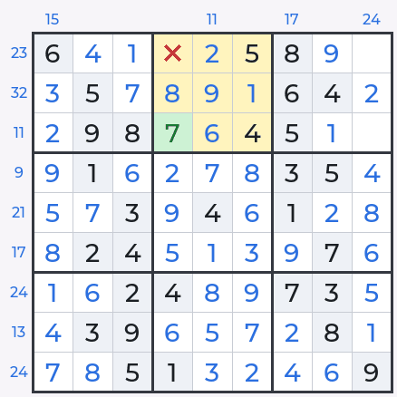

#### Step 50: the 3 in box 2

Box 2 needs a 3, and r1c4 is its last empty cell: **r1c4 = 3**.

#### Step 51: the 3 in box 3

Box 3 needs a 3. r1c9: row 1 has one (r1c4). Only **r3c9** is left: **r3c9 = 3**.

#### Step 52: the 7 in box 3

Box 3 needs a 7, and r1c9 is its last empty cell: **r1c9 = 7**.

Solved.

<!-- /walkthrough -->
