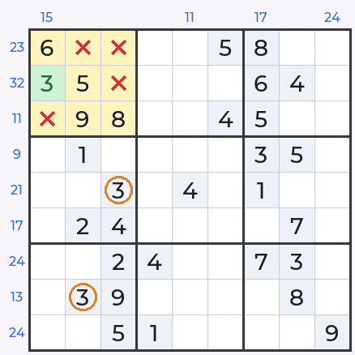

<!-- Written by tools/walkthrough.py sum-skyscrapers: edit the script, not this page. -->
# Sum Skyscrapers, step 1: the 3 in box 1

**Step 1 of 52** · [← The start](../sum-skyscrapers.md#the-whole-puzzle-step-by-step) · [All steps](../sum-skyscrapers.md#the-whole-puzzle-step-by-step) · [Step 2 →](step-02.md)

Box 1 needs a 3. r1c2: column 2 has one (r8c2). r1c3 and r2c3: column 3 has one (r5c3). r3c1: it's the first cell after a clue of 11: it's seen, and so is the 9 later, so it's at most 2. Only **r2c1** is left: **r2c1 = 3**.

**Step 1 of 52** · [← The start](../sum-skyscrapers.md#the-whole-puzzle-step-by-step) · [All steps](../sum-skyscrapers.md#the-whole-puzzle-step-by-step) · [Step 2 →](step-02.md)
