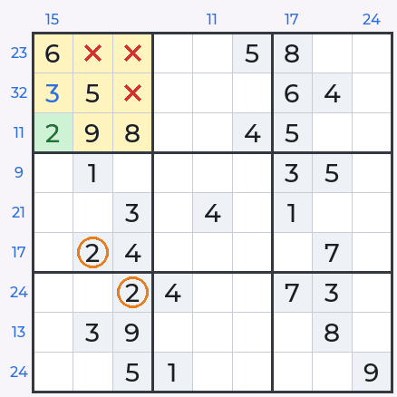

<!-- Written by tools/walkthrough.py sum-skyscrapers: edit the script, not this page. -->
# Sum Skyscrapers, step 2: the 2 in box 1

**Step 2 of 52** · [← Step 1](step-01.md) · [All steps](../sum-skyscrapers.md#the-whole-puzzle-step-by-step) · [Step 3 →](step-03.md)

Box 1 needs a 2. r1c2: column 2 has one (r6c2). r1c3 and r2c3: column 3 has one (r7c3). Only **r3c1** is left: **r3c1 = 2**.

**Step 2 of 52** · [← Step 1](step-01.md) · [All steps](../sum-skyscrapers.md#the-whole-puzzle-step-by-step) · [Step 3 →](step-03.md)
