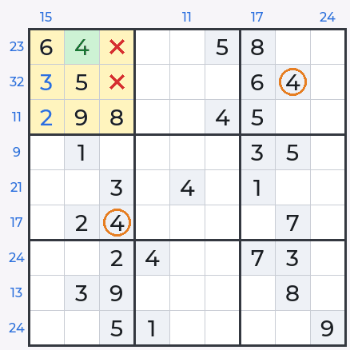

<!-- Written by tools/walkthrough.py sum-skyscrapers: edit the script, not this page. -->
# Sum Skyscrapers, step 3: the 4 in box 1

**Step 3 of 52** · [← Step 2](step-02.md) · [All steps](../sum-skyscrapers.md#the-whole-puzzle-step-by-step) · [Step 4 →](step-04.md)

Box 1 needs a 4. r1c3: column 3 has one (r6c3). r2c3: row 2 has one (r2c8). Only **r1c2** is left: **r1c2 = 4**.

**Step 3 of 52** · [← Step 2](step-02.md) · [All steps](../sum-skyscrapers.md#the-whole-puzzle-step-by-step) · [Step 4 →](step-04.md)
