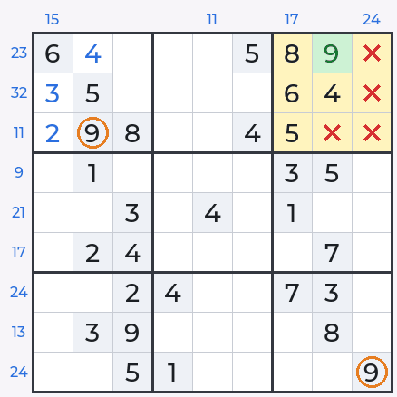

<!-- Written by tools/walkthrough.py sum-skyscrapers: edit the script, not this page. -->
# Sum Skyscrapers, step 4: the 9 in box 3

**Step 4 of 52** · [← Step 3](step-03.md) · [All steps](../sum-skyscrapers.md#the-whole-puzzle-step-by-step) · [Step 5 →](step-05.md)

Box 3 needs a 9. r1c9 and r2c9: column 9 has one (r9c9). r3c8 and r3c9: row 3 has one (r3c2). Only **r1c8** is left: **r1c8 = 9**.

**Step 4 of 52** · [← Step 3](step-03.md) · [All steps](../sum-skyscrapers.md#the-whole-puzzle-step-by-step) · [Step 5 →](step-05.md)
