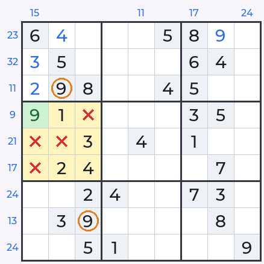

<!-- Written by tools/walkthrough.py sum-skyscrapers: edit the script, not this page. -->
# Sum Skyscrapers, step 5: the 9 in box 4

**Step 5 of 52** · [← Step 4](step-04.md) · [All steps](../sum-skyscrapers.md#the-whole-puzzle-step-by-step) · [Step 6 →](step-06.md)

Box 4 needs a 9. r4c3: column 3 has one (r8c3). r5c2: column 2 has one (r3c2). r5c1: it's the first cell after a clue of 21: a 9 first would be all that's seen, 9. r6c1: it's the first cell after a clue of 17: a 9 first would be all that's seen, 9. Only **r4c1** is left: **r4c1 = 9**.

**Step 5 of 52** · [← Step 4](step-04.md) · [All steps](../sum-skyscrapers.md#the-whole-puzzle-step-by-step) · [Step 6 →](step-06.md)
