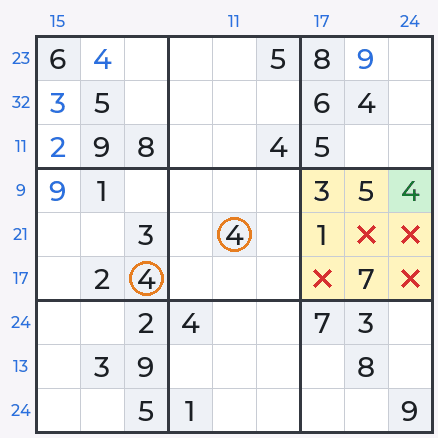

<!-- Written by tools/walkthrough.py sum-skyscrapers: edit the script, not this page. -->
# Sum Skyscrapers, step 6: the 4 in box 6

**Step 6 of 52** · [← Step 5](step-05.md) · [All steps](../sum-skyscrapers.md#the-whole-puzzle-step-by-step) · [Step 7 →](step-07.md)

Box 6 needs a 4. r5c8 and r5c9: row 5 has one (r5c5). r6c7 and r6c9: row 6 has one (r6c3). Only **r4c9** is left: **r4c9 = 4**.

**Step 6 of 52** · [← Step 5](step-05.md) · [All steps](../sum-skyscrapers.md#the-whole-puzzle-step-by-step) · [Step 7 →](step-07.md)
