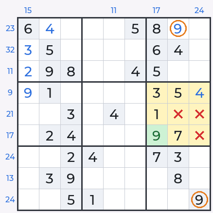

<!-- Written by tools/walkthrough.py sum-skyscrapers: edit the script, not this page. -->
# Sum Skyscrapers, step 7: the 9 in box 6

**Step 7 of 52** · [← Step 6](step-06.md) · [All steps](../sum-skyscrapers.md#the-whole-puzzle-step-by-step) · [Step 8 →](step-08.md)

Box 6 needs a 9. r5c8: column 8 has one (r1c8). r5c9 and r6c9: column 9 has one (r9c9). Only **r6c7** is left: **r6c7 = 9**.

**Step 7 of 52** · [← Step 6](step-06.md) · [All steps](../sum-skyscrapers.md#the-whole-puzzle-step-by-step) · [Step 8 →](step-08.md)
