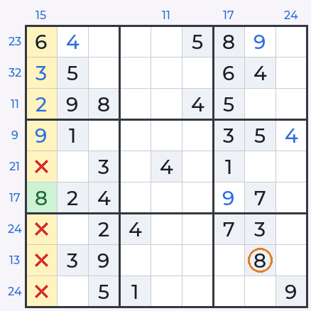

<!-- Written by tools/walkthrough.py sum-skyscrapers: edit the script, not this page. -->
# Sum Skyscrapers, step 8: the 8 in column 1

**Step 8 of 52** · [← Step 7](step-07.md) · [All steps](../sum-skyscrapers.md#the-whole-puzzle-step-by-step) · [Step 9 →](step-09.md)

Column 1 needs an 8. r8c1: row 8 has one (r8c8). r5c1: seen from the left of row 5, an 8 there would leave too little to make its clue 21. r7c1: seen from the left of row 7, an 8 there would leave too little to make its clue 24. r9c1: seen from the left of row 9, an 8 there would leave too little to make its clue 24. Only **r6c1** is left: **r6c1 = 8**.

**Step 8 of 52** · [← Step 7](step-07.md) · [All steps](../sum-skyscrapers.md#the-whole-puzzle-step-by-step) · [Step 9 →](step-09.md)
