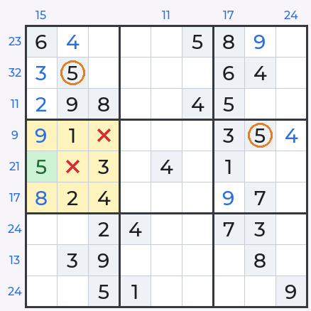

<!-- Written by tools/walkthrough.py sum-skyscrapers: edit the script, not this page. -->
# Sum Skyscrapers, step 9: the 5 in box 4

**Step 9 of 52** · [← Step 8](step-08.md) · [All steps](../sum-skyscrapers.md#the-whole-puzzle-step-by-step) · [Step 10 →](step-10.md)

Box 4 needs a 5. r4c3: row 4 has one (r4c8). r5c2: column 2 has one (r2c2). Only **r5c1** is left: **r5c1 = 5**.

**Step 9 of 52** · [← Step 8](step-08.md) · [All steps](../sum-skyscrapers.md#the-whole-puzzle-step-by-step) · [Step 10 →](step-10.md)
