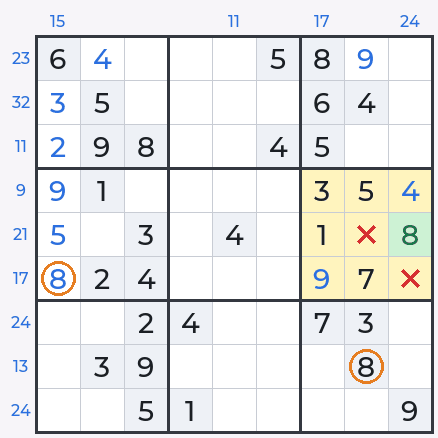

<!-- Written by tools/walkthrough.py sum-skyscrapers: edit the script, not this page. -->
# Sum Skyscrapers, step 10: the 8 in box 6

**Step 10 of 52** · [← Step 9](step-09.md) · [All steps](../sum-skyscrapers.md#the-whole-puzzle-step-by-step) · [Step 11 →](step-11.md)

Box 6 needs an 8. r5c8: column 8 has one (r8c8). r6c9: row 6 has one (r6c1). Only **r5c9** is left: **r5c9 = 8**.

**Step 10 of 52** · [← Step 9](step-09.md) · [All steps](../sum-skyscrapers.md#the-whole-puzzle-step-by-step) · [Step 11 →](step-11.md)
