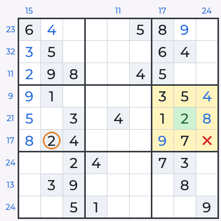

<!-- Written by tools/walkthrough.py sum-skyscrapers: edit the script, not this page. -->
# Sum Skyscrapers, step 11: the 2 in box 6

**Step 11 of 52** · [← Step 10](step-10.md) · [All steps](../sum-skyscrapers.md#the-whole-puzzle-step-by-step) · [Step 12 →](step-12.md)

Box 6 needs a 2. r6c9: row 6 has one (r6c2). Only **r5c8** is left: **r5c8 = 2**.

**Step 11 of 52** · [← Step 10](step-10.md) · [All steps](../sum-skyscrapers.md#the-whole-puzzle-step-by-step) · [Step 12 →](step-12.md)
