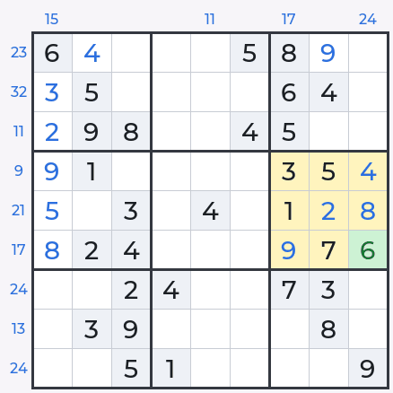

<!-- Written by tools/walkthrough.py sum-skyscrapers: edit the script, not this page. -->
# Sum Skyscrapers, step 12: the 6 in box 6

**Step 12 of 52** · [← Step 11](step-11.md) · [All steps](../sum-skyscrapers.md#the-whole-puzzle-step-by-step) · [Step 13 →](step-13.md)

Box 6 needs a 6, and r6c9 is its last empty cell: **r6c9 = 6**.

**Step 12 of 52** · [← Step 11](step-11.md) · [All steps](../sum-skyscrapers.md#the-whole-puzzle-step-by-step) · [Step 13 →](step-13.md)
