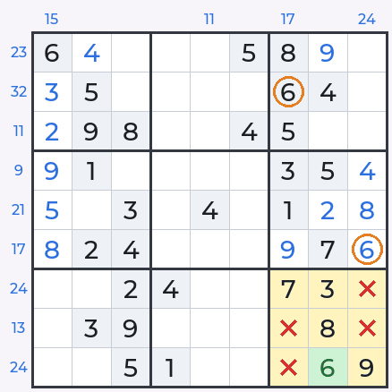

<!-- Written by tools/walkthrough.py sum-skyscrapers: edit the script, not this page. -->
# Sum Skyscrapers, step 13: the 6 in box 9

**Step 13 of 52** · [← Step 12](step-12.md) · [All steps](../sum-skyscrapers.md#the-whole-puzzle-step-by-step) · [Step 14 →](step-14.md)

Box 9 needs a 6. r7c9 and r8c9: column 9 has one (r6c9). r8c7 and r9c7: column 7 has one (r2c7). Only **r9c8** is left: **r9c8 = 6**.

**Step 13 of 52** · [← Step 12](step-12.md) · [All steps](../sum-skyscrapers.md#the-whole-puzzle-step-by-step) · [Step 14 →](step-14.md)
