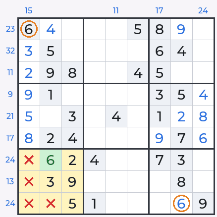

<!-- Written by tools/walkthrough.py sum-skyscrapers: edit the script, not this page. -->
# Sum Skyscrapers, step 14: the 6 in box 7

**Step 14 of 52** · [← Step 13](step-13.md) · [All steps](../sum-skyscrapers.md#the-whole-puzzle-step-by-step) · [Step 15 →](step-15.md)

Box 7 needs a 6. r7c1 and r8c1: column 1 has one (r1c1). r9c1 and r9c2: row 9 has one (r9c8). Only **r7c2** is left: **r7c2 = 6**.

**Step 14 of 52** · [← Step 13](step-13.md) · [All steps](../sum-skyscrapers.md#the-whole-puzzle-step-by-step) · [Step 15 →](step-15.md)
