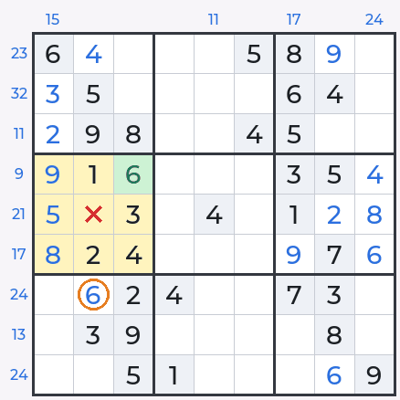

<!-- Written by tools/walkthrough.py sum-skyscrapers: edit the script, not this page. -->
# Sum Skyscrapers, step 15: the 6 in box 4

**Step 15 of 52** · [← Step 14](step-14.md) · [All steps](../sum-skyscrapers.md#the-whole-puzzle-step-by-step) · [Step 16 →](step-16.md)

Box 4 needs a 6. r5c2: column 2 has one (r7c2). Only **r4c3** is left: **r4c3 = 6**.

**Step 15 of 52** · [← Step 14](step-14.md) · [All steps](../sum-skyscrapers.md#the-whole-puzzle-step-by-step) · [Step 16 →](step-16.md)
