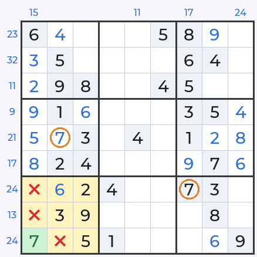

<!-- Written by tools/walkthrough.py sum-skyscrapers: edit the script, not this page. -->
# Sum Skyscrapers, step 17: the 7 in box 7

**Step 17 of 52** · [← Step 16](step-16.md) · [All steps](../sum-skyscrapers.md#the-whole-puzzle-step-by-step) · [Step 18 →](step-18.md)

Box 7 needs a 7. r7c1: row 7 has one (r7c7). r9c2: column 2 has one (r5c2). r8c1: it's the first cell after a clue of 13: it's seen, and so is the 9 later, so it's at most 4. Only **r9c1** is left: **r9c1 = 7**.

**Step 17 of 52** · [← Step 16](step-16.md) · [All steps](../sum-skyscrapers.md#the-whole-puzzle-step-by-step) · [Step 18 →](step-18.md)
