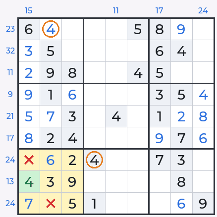

<!-- Written by tools/walkthrough.py sum-skyscrapers: edit the script, not this page. -->
# Sum Skyscrapers, step 18: the 4 in box 7

**Step 18 of 52** · [← Step 17](step-17.md) · [All steps](../sum-skyscrapers.md#the-whole-puzzle-step-by-step) · [Step 19 →](step-19.md)

Box 7 needs a 4. r7c1: row 7 has one (r7c4). r9c2: column 2 has one (r1c2). Only **r8c1** is left: **r8c1 = 4**.

**Step 18 of 52** · [← Step 17](step-17.md) · [All steps](../sum-skyscrapers.md#the-whole-puzzle-step-by-step) · [Step 19 →](step-19.md)
