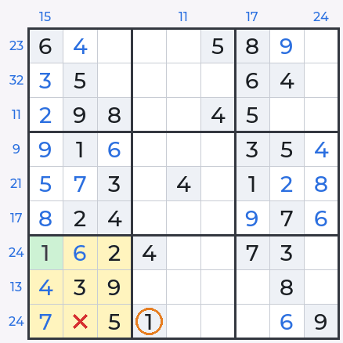

<!-- Written by tools/walkthrough.py sum-skyscrapers: edit the script, not this page. -->
# Sum Skyscrapers, step 19: the 1 in box 7

**Step 19 of 52** · [← Step 18](step-18.md) · [All steps](../sum-skyscrapers.md#the-whole-puzzle-step-by-step) · [Step 20 →](step-20.md)

Box 7 needs a 1. r9c2: row 9 has one (r9c4). Only **r7c1** is left: **r7c1 = 1**.

**Step 19 of 52** · [← Step 18](step-18.md) · [All steps](../sum-skyscrapers.md#the-whole-puzzle-step-by-step) · [Step 20 →](step-20.md)
