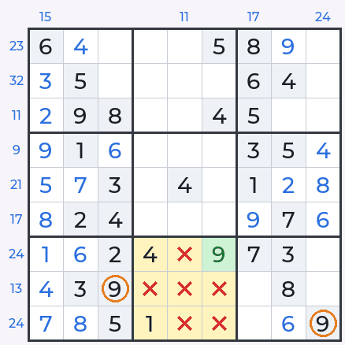

<!-- Written by tools/walkthrough.py sum-skyscrapers: edit the script, not this page. -->
# Sum Skyscrapers, step 21: the 9 in box 8

**Step 21 of 52** · [← Step 20](step-20.md) · [All steps](../sum-skyscrapers.md#the-whole-puzzle-step-by-step) · [Step 22 →](step-22.md)

Box 8 needs a 9. r8c4, r8c5 and r8c6: row 8 has one (r8c3). r9c5 and r9c6: row 9 has one (r9c9). r7c5: seen from the left of row 7, 1, 6 and 9 would add up to 16 with a 9 there, not its clue 24. Only **r7c6** is left: **r7c6 = 9**.

**Step 21 of 52** · [← Step 20](step-20.md) · [All steps](../sum-skyscrapers.md#the-whole-puzzle-step-by-step) · [Step 22 →](step-22.md)
