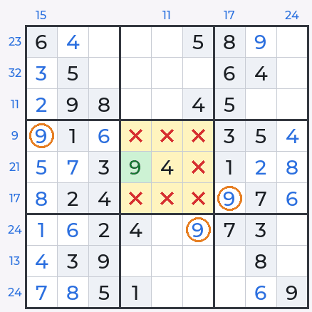

<!-- Written by tools/walkthrough.py sum-skyscrapers: edit the script, not this page. -->
# Sum Skyscrapers, step 22: the 9 in box 5

**Step 22 of 52** · [← Step 21](step-21.md) · [All steps](../sum-skyscrapers.md#the-whole-puzzle-step-by-step) · [Step 23 →](step-23.md)

Box 5 needs a 9. r4c4, r4c5 and r4c6: row 4 has one (r4c1). r5c6: column 6 has one (r7c6). r6c4, r6c5 and r6c6: row 6 has one (r6c7). Only **r5c4** is left: **r5c4 = 9**.

**Step 22 of 52** · [← Step 21](step-21.md) · [All steps](../sum-skyscrapers.md#the-whole-puzzle-step-by-step) · [Step 23 →](step-23.md)
