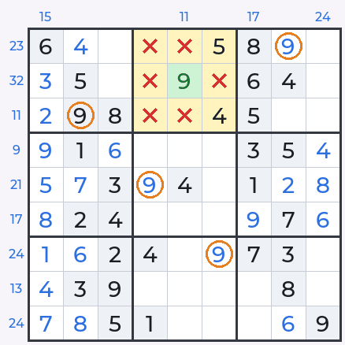

<!-- Written by tools/walkthrough.py sum-skyscrapers: edit the script, not this page. -->
# Sum Skyscrapers, step 23: the 9 in box 2

**Step 23 of 52** · [← Step 22](step-22.md) · [All steps](../sum-skyscrapers.md#the-whole-puzzle-step-by-step) · [Step 24 →](step-24.md)

Box 2 needs a 9. r1c4 and r1c5: row 1 has one (r1c8). r2c4: column 4 has one (r5c4). r2c6: column 6 has one (r7c6). r3c4 and r3c5: row 3 has one (r3c2). Only **r2c5** is left: **r2c5 = 9**.

**Step 23 of 52** · [← Step 22](step-22.md) · [All steps](../sum-skyscrapers.md#the-whole-puzzle-step-by-step) · [Step 24 →](step-24.md)
