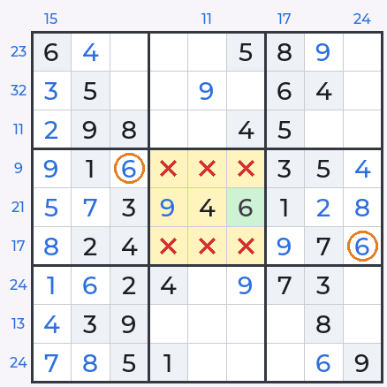

<!-- Written by tools/walkthrough.py sum-skyscrapers: edit the script, not this page. -->
# Sum Skyscrapers, step 24: the 6 in box 5

**Step 24 of 52** · [← Step 23](step-23.md) · [All steps](../sum-skyscrapers.md#the-whole-puzzle-step-by-step) · [Step 25 →](step-25.md)

Box 5 needs a 6. r4c4, r4c5 and r4c6: row 4 has one (r4c3). r6c4, r6c5 and r6c6: row 6 has one (r6c9). Only **r5c6** is left: **r5c6 = 6**.

**Step 24 of 52** · [← Step 23](step-23.md) · [All steps](../sum-skyscrapers.md#the-whole-puzzle-step-by-step) · [Step 25 →](step-25.md)
