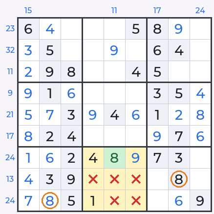

<!-- Written by tools/walkthrough.py sum-skyscrapers: edit the script, not this page. -->
# Sum Skyscrapers, step 25: the 8 in box 8

**Step 25 of 52** · [← Step 24](step-24.md) · [All steps](../sum-skyscrapers.md#the-whole-puzzle-step-by-step) · [Step 26 →](step-26.md)

Box 8 needs an 8. r8c4, r8c5 and r8c6: row 8 has one (r8c8). r9c5 and r9c6: row 9 has one (r9c2). Only **r7c5** is left: **r7c5 = 8**.

**Step 25 of 52** · [← Step 24](step-24.md) · [All steps](../sum-skyscrapers.md#the-whole-puzzle-step-by-step) · [Step 26 →](step-26.md)
