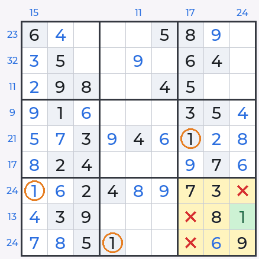

<!-- Written by tools/walkthrough.py sum-skyscrapers: edit the script, not this page. -->
# Sum Skyscrapers, step 26: the 1 in box 9

**Step 26 of 52** · [← Step 25](step-25.md) · [All steps](../sum-skyscrapers.md#the-whole-puzzle-step-by-step) · [Step 27 →](step-27.md)

Box 9 needs a 1. r7c9: row 7 has one (r7c1). r8c7: column 7 has one (r5c7). r9c7: row 9 has one (r9c4). Only **r8c9** is left: **r8c9 = 1**.

**Step 26 of 52** · [← Step 25](step-25.md) · [All steps](../sum-skyscrapers.md#the-whole-puzzle-step-by-step) · [Step 27 →](step-27.md)
