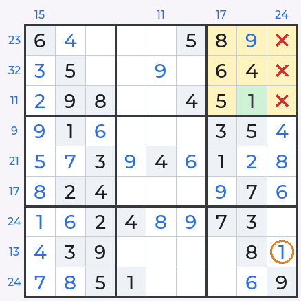

<!-- Written by tools/walkthrough.py sum-skyscrapers: edit the script, not this page. -->
# Sum Skyscrapers, step 27: the 1 in box 3

**Step 27 of 52** · [← Step 26](step-26.md) · [All steps](../sum-skyscrapers.md#the-whole-puzzle-step-by-step) · [Step 28 →](step-28.md)

Box 3 needs a 1. r1c9, r2c9 and r3c9: column 9 has one (r8c9). Only **r3c8** is left: **r3c8 = 1**.

**Step 27 of 52** · [← Step 26](step-26.md) · [All steps](../sum-skyscrapers.md#the-whole-puzzle-step-by-step) · [Step 28 →](step-28.md)
