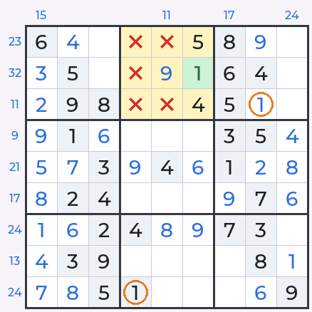

<!-- Written by tools/walkthrough.py sum-skyscrapers: edit the script, not this page. -->
# Sum Skyscrapers, step 28: the 1 in box 2

**Step 28 of 52** · [← Step 27](step-27.md) · [All steps](../sum-skyscrapers.md#the-whole-puzzle-step-by-step) · [Step 29 →](step-29.md)

Box 2 needs a 1. r1c4 and r2c4: column 4 has one (r9c4). r3c4 and r3c5: row 3 has one (r3c8). r1c5: seen from the top of column 5, 1 and 9 would add up to 10 with a 1 there, not its clue 11. Only **r2c6** is left: **r2c6 = 1**.

**Step 28 of 52** · [← Step 27](step-27.md) · [All steps](../sum-skyscrapers.md#the-whole-puzzle-step-by-step) · [Step 29 →](step-29.md)
