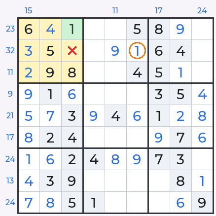

<!-- Written by tools/walkthrough.py sum-skyscrapers: edit the script, not this page. -->
# Sum Skyscrapers, step 29: the 1 in box 1

**Step 29 of 52** · [← Step 28](step-28.md) · [All steps](../sum-skyscrapers.md#the-whole-puzzle-step-by-step) · [Step 30 →](step-30.md)

Box 1 needs a 1. r2c3: row 2 has one (r2c6). Only **r1c3** is left: **r1c3 = 1**.

**Step 29 of 52** · [← Step 28](step-28.md) · [All steps](../sum-skyscrapers.md#the-whole-puzzle-step-by-step) · [Step 30 →](step-30.md)
