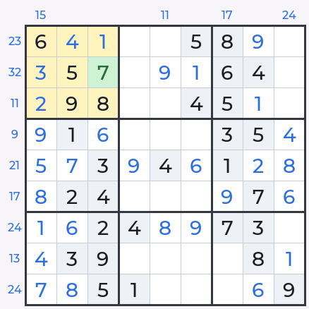

<!-- Written by tools/walkthrough.py sum-skyscrapers: edit the script, not this page. -->
# Sum Skyscrapers, step 30: the 7 in box 1

**Step 30 of 52** · [← Step 29](step-29.md) · [All steps](../sum-skyscrapers.md#the-whole-puzzle-step-by-step) · [Step 31 →](step-31.md)

Box 1 needs a 7, and r2c3 is its last empty cell: **r2c3 = 7**.

**Step 30 of 52** · [← Step 29](step-29.md) · [All steps](../sum-skyscrapers.md#the-whole-puzzle-step-by-step) · [Step 31 →](step-31.md)
